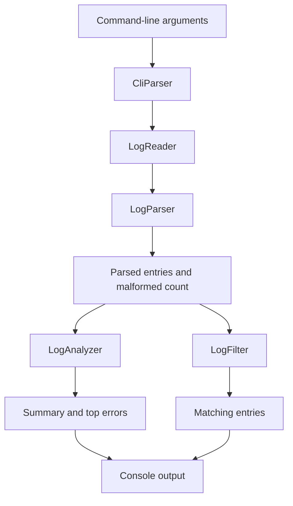
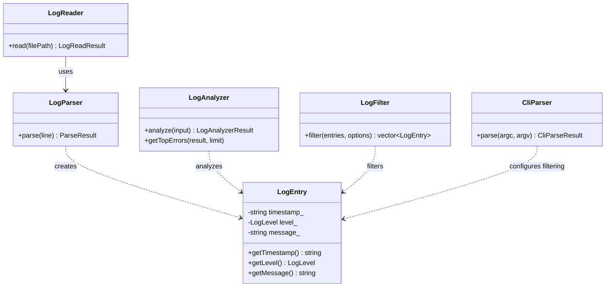

# LogLens

**A lightweight command-line tool for parsing, filtering, and analyzing application logs.**

LogLens is a C++17 CLI utility that turns structured application logs into useful summaries. It parses log entries, tracks severity distributions, identifies recurring errors, and filters entries by severity or message content.

The project is built around small, focused components with clearly defined responsibilities, keeping file I/O, parsing, analysis, filtering, and command-line handling separate.

## Features

- **Structured log parsing** — extracts timestamps, severity levels, and messages from log entries.
- **Malformed input handling** — skips invalid lines while tracking their count.
- **Severity analysis** — summarizes the distribution of `DEBUG`, `INFO`, `WARN`, and `ERROR` entries.
- **Flexible filtering** — filter by severity, case-insensitive keyword, or both.
- **Error frequency analysis** — identifies the most frequent error messages, with alphabetical ordering for ties.
- **Command-line interface** — supports argument validation and useful error messages.
- **Automated tests** — separate test targets for parsing and analysis components.

## Requirements

- C++17-compatible compiler
- CMake 3.16 or newer
- Git

The project has been developed and tested on Linux.

## Build

Clone the repository and enter the project directory:

```bash
git clone <https://github.com/TypicalW/LogLens-CLI.git>
cd LogLens
```

Configure and compile:

```bash
cmake -S . -B build
cmake --build build
```

Run the automated tests:

```bash
ctest --test-dir build --output-on-failure
```

The executable is generated at `build/loglens`.

## Usage

```bash
./build/loglens --help
```


### Analyze a log file

```bash
./build/loglens analyze sample.log
```

This prints the total number of valid entries, the number of malformed lines, and the count for each severity level.

### Filter by severity

```bash
./build/loglens analyze sample.log --level ERROR
```

### Filter by message content

```bash
./build/loglens analyze sample.log --keyword database
```

Keyword matching is case-insensitive.

### Combine filters

```bash
./build/loglens analyze sample.log --level ERROR --keyword database
```

When multiple filters are supplied, an entry must satisfy all active conditions.

### Find recurring errors

```bash
./build/loglens analyze sample.log --top-errors 5
```

The report lists the most frequent error messages in descending order of frequency. Messages with equal frequencies are ordered alphabetically.

Options can be combined:

```bash
./build/loglens analyze sample.log \
    --level ERROR \
    --keyword database \
    --top-errors 3
```

The summary and top-error report describe the full input file; filtering controls which individual entries are displayed.

## Log format

LogLens expects one entry per line, using the following format:

```text
YYYY-MM-DD HH:MM:SS [LEVEL] Message
```

For example:

```text
2026-10-24 10:01:00 [ERROR] Database connection timeout
2026-10-24 10:01:05 [WARN] Retrying database connection
2026-10-24 10:02:00 [INFO] User authentication successful
```

Supported severity levels:

| Level | Description |
|---|---|
| `DEBUG` | Diagnostic information |
| `INFO` | General operational events |
| `WARN` | Potential issues |
| `ERROR` | Errors requiring attention |

Lines that do not match the expected format are counted as malformed and excluded from analysis.

## Architecture

LogLens separates the application into components with distinct responsibilities.

| Component | Responsibility |
|---|---|
| `LogEntry` | Represents a parsed log entry. |
| `LogParser` | Converts a raw line into a `LogEntry` or a parsing error. |
| `LogReader` | Reads the file and collects valid entries and malformed-line counts. |
| `LogAnalyzer` | Calculates severity counts and error-message frequencies. |
| `LogFilter` | Selects entries using the requested severity and keyword conditions. |
| `CliParser` | Validates and interprets command-line arguments. |
| `main` | Coordinates the application workflow and output. |

### Processing flow



The analyzer operates on all successfully parsed entries. Filtering is a separate operation, so requesting a subset of entries does not change the overall summary statistics.

### Class diagram



The diagrams describe the intended component relationships; keep them synchronized with the actual declarations as the code evolves.

## Testing

The test suite is organized into separate CMake targets. Run all registered tests with:

```bash
ctest --test-dir build --output-on-failure
```

Manual checks can be performed with the sample log file:

```bash
./build/loglens analyze sample.log
./build/loglens analyze sample.log --level ERROR
./build/loglens analyze sample.log --keyword database
./build/loglens analyze sample.log --top-errors 2
```

Additional checks should cover missing files, malformed input, invalid severity levels, missing option values, unknown flags, and empty results.

## Design considerations

- **Separation of concerns:** parsing, file access, analysis, filtering, and CLI handling are independent responsibilities.
- **Explicit error handling:** parsing errors are distinguished from valid entries, while file-access failures are reported separately.
- **Non-destructive filtering:** filters produce a separate collection of matching entries rather than modifying the original input.
- **Deterministic reporting:** top-error results use a defined tie-breaking rule.
- **Standard C++:** the implementation uses C++17 and the standard library without requiring an external runtime dependency.

## Scope and limitations

LogLens currently targets files that follow its defined log format. It is not a live log monitor, a distributed log aggregation service, or a general-purpose parser for arbitrary logging formats.

Potential extensions include configurable timestamp formats, date-range filtering, additional output formats, and integration with continuous integration pipelines.

